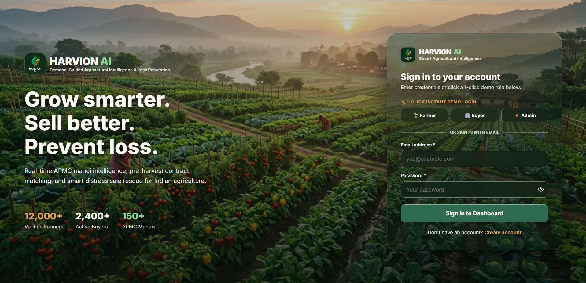
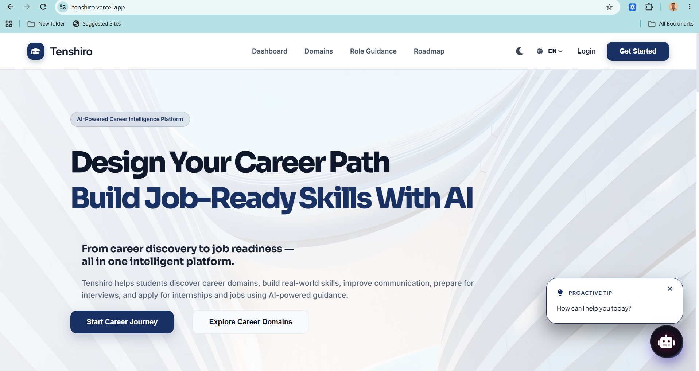
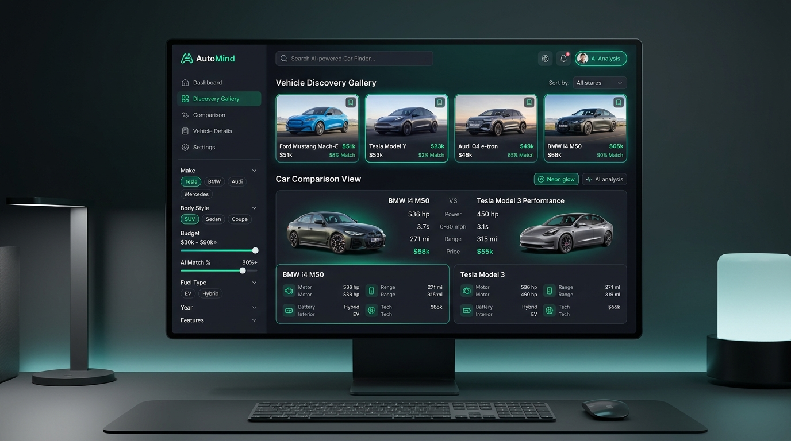

## Hi there 👋

<div align="center">


<br/>


<br/>


<br/>

<a href="https://babutechiee.vercel.app/" target="_blank"></a>
<a href="https://www.linkedin.com/in/babuvishwanathanofficial/" target="_blank"></a>
<a href="https://github.com/babutechinfo03-blip" target="_blank"></a>
<a href="mailto:babutechinfo03@gmail.com"></a>

<br/>


</div>

<br/>

## 👨‍💻 About Me

<blockquote>
<h4>Aspiring Software Engineer skilled in full-stack web development, Java programming, the MERN Stack (MongoDB, Express.js, React.js, Node.js), and AI systems. Strong foundation in Data Structures and Algorithms (DSA), Object-Oriented Programming (OOP), RESTful APIs, and software engineering principles. Focused on developing scalable, efficient, and reliable software with a strong emphasis on code quality, maintainability, software maintenance, testing, performance optimization, and continuous innovation.</h4>
</blockquote>

```bash
ROLE      : Software Engineer | Full Stack Developer
EXP       : 3 Internships (Strydo Technologies · Codec Technologies · CodeAlpha)
EDUCATION : B.Tech IT '23-'27 (CGPA: 7.8/10) · M.P.N.M.J. Engineering College
CORE STACK: Java, JavaScript, Python, React.js, Node.js, Express.js, Spring Boot, MySQL, MongoDB
FOCUS     : Scalable Full-Stack Systems · REST APIs & Microservices · AI-Integrated Platforms
OPEN TO   : Software Engineer (SDE) · Full Stack Developer · AI/ML Engineering
```

<br/>

## 🛠️ Technical Skills

<div align="center">

<p align="center">
  
</p>
<p align="center">
  <b>💻 Languages & Frontend</b>
</p>

<br/>

<p align="center">
  
</p>
<p align="center">
  <b>⚙️ Backend & Databases</b>
</p>

<br/>

<p align="center">
  
</p>
<p align="center">
  <b>🚀 DevOps, Cloud & Tools</b>
</p>

<br/>

<table>
<tr>
<td align="right" width="22%"><b>🧠 Core CS</b></td>
<td align="left">


</td>
</tr>
<tr>
<td align="right"><b>🤖 AI & ML</b></td>
<td align="left">


</td>
</tr>
<tr>
<td align="right"><b>⚡ Frameworks & APIs</b></td>
<td align="left">


</td>
</tr>
</table>

</div>

<br/>

## 💼 Work Experience

<table>
<tr><td>

### 🚀 Strydo Technologies Pvt. Ltd.
  

- **Integrated LLM APIs** (OpenAI SDK, Groq Llama 3.3 70B) in 5 backend controllers: AI mentor, interview prep, resume analysis.
- **Implemented JWT and Google OAuth 2.0 login** and a webcam-proctored exam flow with face detection and integrity scoring.

<hr style="border:none;border-top:1px solid #39FF14;opacity:0.25;margin:12px 0;">

     

</td></tr>
</table>

<br/>

<table>
<tr><td>

### ☕ Codec Technologies
  

- **Developed an ERP backend** (Java 21, Spring Boot 3): **115 REST endpoints, 20 controllers, 10 services, 28 JPA repositories**.
- **Designed 29 JPA entities** in MySQL and secured endpoints using JWT, Spring Security and 8 roles (**38 @PreAuthorize guards**).
- **Built STOMP WebSocket live updates** and containerized the backend, frontend and MySQL 8 with **Docker Compose**.
- **Generated a test dataset** of 4,440 students, 423 faculty and 444,000 attendance records across 25 departments.

<hr style="border:none;border-top:1px solid #39FF14;opacity:0.25;margin:12px 0;">

    

</td></tr>
</table>

<br/>

<table>
<tr><td>

### 🎨 CodeAlpha
  

- **Designed a responsive React 19 and Tailwind CSS portfolio** with 10 sections and 10 reusable components.
- **Implemented Framer Motion animations in 15 files**; production build is **138 kB gzipped JS and 13 kB gzipped CSS**.

<hr style="border:none;border-top:1px solid #39FF14;opacity:0.25;margin:12px 0;">

   

</td></tr>
</table>

<br/>

## 🌟 Featured Projects

<table>
<tr>

<td width="33.3%" valign="top">

<a href="https://agri-pulse-pied.vercel.app/" target="_blank">
  
</a>

<br/><br/>

### 🌾 Harvion AI
**Smart Agricultural System**

 

**Scale:** 39 pages &middot; 74 APIs &middot; 20 models

- **Full-stack platform** with React.js, Node.js, Express.js, MongoDB, FastAPI.
- **Random Forest model** (29 crops, 8,700 samples) with 8 passing unit tests.
- **JWT role-based access**, rate limiting, Redis caching, Socket.io alerts, and 8-language UI.

🔗 **[Repository](https://github.com/babutechinfo03-blip/Harvion-AI)** &nbsp;|&nbsp; 🌐 **[Live](https://agri-pulse-pied.vercel.app/)**

</td>

<td width="33.3%" valign="top">

<a href="https://tenshiro.vercel.app/" target="_blank">
  
</a>

<br/><br/>

### 🧭 Tenshiro
**AI Career Platform**

 

**Scale:** 23 pages &middot; 74 endpoints &middot; 15 tables

- **AI career platform** with React.js, Node.js, MySQL, and OpenAI SDK.
- **Delivered AI mentoring**, learning roadmaps, interview prep, and resume analysis across 18 domains & 153 roles.

🔗 **[Repository](https://github.com/babutechinfo03-blip/Tenshiro)** &nbsp;|&nbsp; 🌐 **[Live](https://tenshiro.vercel.app/)**

</td>

<td width="33.3%" valign="top">

<a href="https://carvendhan.netlify.app/" target="_blank">
  
</a>

<br/><br/>

### 🚗 AutoMind
**AI Car Finder**

 

**Scale:** 55 cars &middot; 6 categories &middot; 10 pages

- **Car discovery app** built with React.js, TypeScript, Tailwind CSS, and Supabase.
- **Search & filtering**, intelligent recommendations, vehicle comparison, and favorites.

🔗 **[Repository](https://github.com/Babuvishwanathan17/automind-car-finder)** &nbsp;|&nbsp; 🌐 **[Live](https://carvendhan.netlify.app/)**

</td>

</tr>
</table>

<br/>

## 🎓 Education

<div align="center">

<table>
<tr>
<th align="left">Degree / Certificate</th>
<th align="left">Institution</th>
<th align="center">Timeline</th>
<th align="center">Score</th>
</tr>
<tr>
<td><b>B.Tech. – Information Technology</b></td>
<td>M.P.N.M.J. Engineering College, Erode, Tamil Nadu</td>
<td align="center">2023 – 2027 (Expected)</td>
<td align="center"></td>
</tr>
<tr>
<td><b>Higher Secondary Certificate (HSC)</b></td>
<td>Govt Boys Higher Secondary School Ponnai, Vellore</td>
<td align="center">2023 (Completed)</td>
<td align="center"></td>
</tr>
<tr>
<td><b>Secondary School Leaving Certificate (SSLC)</b></td>
<td>Govt Boys Higher Secondary School Ponnai, Vellore</td>
<td align="center">2021 (Completed)</td>
<td align="center"></td>
</tr>
</table>

</div>

<br/>

## 🏆 Achievements & Participation

<div align="center">

<table>
<tr>
<td width="70%"><b>Finalist</b> — Protothon Hackathon, Chennai</td>
<td align="center" width="30%"></td>
</tr>
<tr>
<td><b>Winner</b> — Intra-College Hackathon</td>
<td align="center"></td>
</tr>
<tr>
<td><b>Runner-Up</b> — TECHNOVANZA-2K26 Hackathon</td>
<td align="center"></td>
</tr>
</table>

</div>

<br/>

## 📜 Certifications

<div align="center">

<table>
<tr>
<td width="70%"><b>Software Engineer</b> — HackerRank</td>
<td align="center" width="30%"><a href="https://www.hackerrank.com/certificates/d71ba9aaba99" target="_blank"></a></td>
</tr>
<tr>
<td><b>Cyber Security</b> — Naan Mudhalvan</td>
<td align="center"><a href="https://drive.google.com/file/d/1LGZqi4d1tAxLS9K31jIKtRExZ_NVhQLx/view?usp=drive_link" target="_blank"></a></td>
</tr>
<tr>
<td><b>Python</b> — Novitech</td>
<td align="center"><a href="https://docs.google.com/document/d/14NH9PoaY6Fu0494epV03PZLWWYKQ3WF3/edit?usp=drive_link&ouid=101537972255391387869" target="_blank"></a></td>
</tr>
</table>

</div>

<br/>

## 📊 GitHub Analytics

<div align="center">


<br/>


</div>

<br/>

## 📈 Activity Graph

<div align="center">

</div>

<br/>

## 🐍 Contribution Snake

<div align="center">

</div>

<br/>

## 🎯 Interests

<div align="center">

**Technical**
<br/>
  

<br/><br/>

**Non-Technical**
<br/>
   

</div>

<br/>

## 📬 Connect With Me

<div align="center">

<a href="https://babutechiee.vercel.app/" target="_blank"></a>
<a href="https://www.linkedin.com/in/babuvishwanathanofficial/" target="_blank"></a>
<a href="https://github.com/babutechinfo03-blip" target="_blank"></a>
<a href="mailto:babutechinfo03@gmail.com"></a>

<br/><br/>

*"Code with purpose, build with passion, ship with pride."*

</div>


